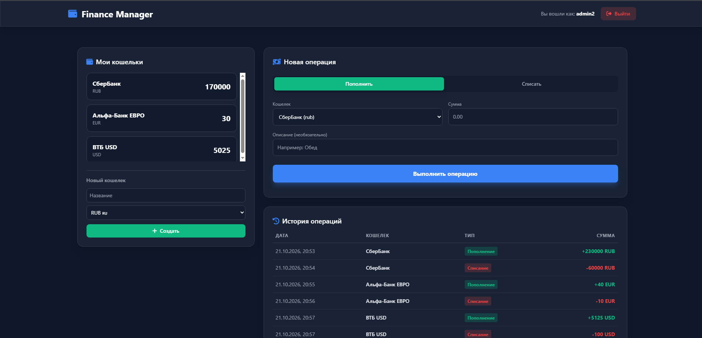

# 💰 Finance Manager API

Полноценный Fullstack-сервис для управления личными финансами. 
Позволяет создавать кошельки в разных валютах, отслеживать доходы/расходы и вести историю транзакций. 
Проект написан с упором на **чистую архитектуру (DDD-lite)**, **асинхронность** и современные практики разработки на Python.

## 🛠 Стек технологий

* **Backend:** Python 3.12, FastAPI, SQLAlchemy 2.0 (Async), Pydantic (валидация)
* **База данных:** PostgreSQL 16, Alembic (миграции), asyncpg (асинхронный драйвер)
* **Архитектура:** DDD-lite (Repository, Unit of Work, UseCases)
* **DI (Dependency Injection):** dependency-injector
* **Инфраструктура:** Docker, Docker Compose
* **Тестирование и качество кода:** Pytest (интеграционные тесты), Ruff (линтер), Mypy (статическая типизация)
* **Frontend:** HTML5, TailwindCSS, Vanilla JS (раздается напрямую из FastAPI)

## 📸 Скриншот интерфейса



# 🚀 Как запустить проект

Для запуска вам понадобятся установленные **Docker** и **Docker Compose**.

1. Клонируйте репозиторий:
   ```bash
   git clone https://github.com/pizhonnn/finance-manager-api.git
   cd finance-manager-api
   ```
2. Создайте файл .env в корне проекта:
```text
POSTGRES_USER=postgres
POSTGRES_PASSWORD=admin
POSTGRES_DB=postgres
POSTGRES_HOST=db
POSTGRES_PORT=5432
```

3. Запустите контейнеры:
```bash
docker compose up --build
```
4. Приложение будет доступно по адресам:

   **Фронтенд: http://localhost:8080/**

   **Swagger UI (Документация API): http://localhost:8080/docs**

# 🎬 Тестирование

Проект покрыт интеграционными тестами с использованием Pytest и SQLite (in-memory). Тесты изолированы и не требуют запущенной базы данных PostgreSQL.

*Установите зависимости локально*
```
pip install -r requirements.txt
```
*Запустите тесты*
```
pytest tests/ -v
```
# ✏ Миграции базы данных

В проекте используется Alembic для контроля версий схемы базы данных. При первом запуске таблицы создаются автоматически (в Docker), но если вы хотите применить миграции вручную:
```
alembic upgrade head
```

# 🏗 Архитектура проекта

Проект построен по паттерну DDD-lite (без сложного слоя Domain) для четкого разделения ответственности:

app/api — Роутеры (тонкие, только вызывают UseCases). Версионирование через v1/router.py.

app/repository — Классы для работы с БД (доменные методы: get_by_login, create, get_by_wallet_ids).

app/usecases — Бизнес-логика (классы с методом execute, не зависят от FastAPI и HTTP).

app/uow.py — Unit of Work (управление транзакциями: commit/rollback).

app/container.py — DI-контейнер (dependency_injector) для управления зависимостями.

app/models — ORM-модели (SQLAlchemy).

app/schemas — Схемы Pydantic (валидация запросов и ответов).

app/config.py — Настройки (Pydantic Settings).

app/dependency.py — Зависимости (get_db, get_current_user).

tests — Интеграционные тесты (Pytest).


*Автор: [pizhonnn](https://github.com/pizhonnn)*
